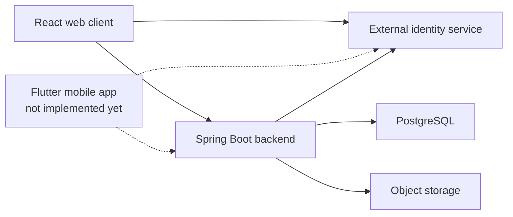

# MINIS Project Context

## Product

MINIS is a mobile-first short-form vertical mini-film platform. A deployable release is targeted in approximately eight weeks.

The Spring Boot backend and current React web/event client already exist. The Flutter mobile application and production setup are not implemented yet.

Additional social, moderation and creator features exist in the broader product direction, but they are outside this task unless they affect deployment, media handling or store requirements.

## Known Company Constraints

MINIS is a startup with very limited budget and low operational capacity. The company does not own hosting hardware, so cloud/online deployment is required.

The company controls `end-int.com` and can create subdomains. The Apple Developer account is currently expected to be Individual.

Budget, expected usage, account ownership, mobile-account status, Mac/Xcode access and operational ownership still need to be confirmed during the research.

## Current Technical Setup

The backend uses Java 21 and Spring Boot. It follows a modular-monolith direction.

PostgreSQL is the business database. Flyway handles schema migrations.

Firebase Authentication is the current external identity service. MINIS owns application roles and account status. Internal MINIS user IDs are independent from the external identity provider.

React is the current web/event client. Flutter is planned for the mobile app but is not implemented yet.

MinIO is currently used for local/demo media storage. Docker Compose and NGINX are used for the current demo environment.

Firebase and MinIO describe the current implementation. The research may recommend keeping or replacing them where justified.

## Current Capabilities

The current project includes:

* authentication and account bootstrap
* backend-owned roles and account status
* creator/basic administration support
* media/content read path
* object-storage integration
* signed media access
* PostgreSQL/Flyway foundation
* current React client

## Still Needed for Release

The release still needs:

* production hosting
* managed PostgreSQL hosting decision
* production object storage
* creator/mobile upload
* video processing and delivery decisions
* Flutter implementation
* minimum production operations
* Android/iOS release preparation
* privacy, account deletion and store-readiness work

## Fixed for This Release

Fixed decisions:

* Java 21 + Spring Boot remains
* modular monolith remains
* PostgreSQL remains the business database technology
* Flyway remains
* Flutter remains the mobile technology
* MINIS continues to own authorization, roles and account status
* internal MINIS user IDs remain independent from the external identity service

Open decisions:

* hosting providers
* PostgreSQL hosting provider
* object storage
* external identity provider, if changing it is justified
* upload approach
* video processing/delivery approach
* minimum production operations

A fixed decision should only be reopened if a release-blocking issue is discovered.

## Current Architecture

* The external identity service verifies identity.
* MINIS stores business data, roles and account status in its backend/database.

If a MINIS-specific implementation detail is needed, ask the MINIS Backend Owner.
